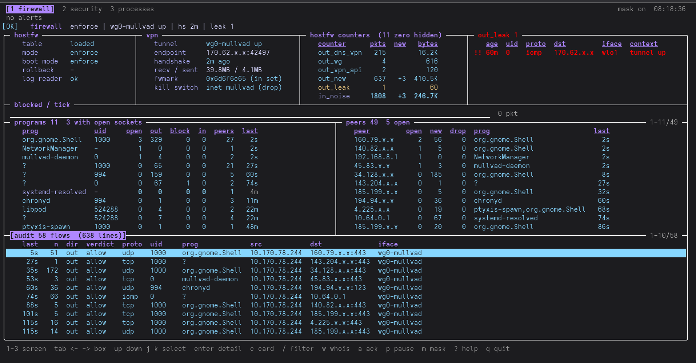
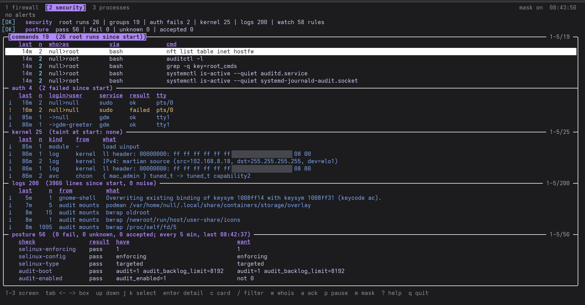
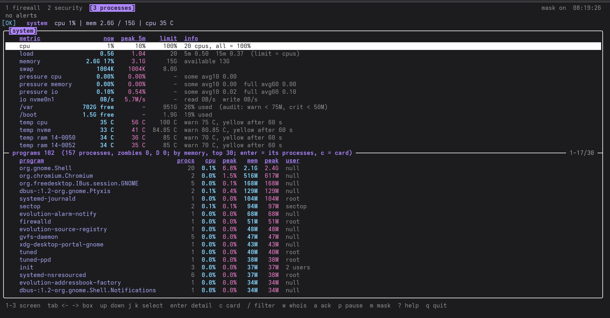

# sectop

Terminal security dashboard for my Fedora Silverblue workstation: firewall and VPN
traffic per program, root commands, logins, kernel events, logs, and whether my
hardening baseline still holds. Like btop, but for security. Python 3 stdlib only
(curses, tomllib), no third-party packages, nothing runs as root.

> **Status: v0.1, built for one machine.** It reads what
> [silverblue-cis-hardening](https://github.com/ghaith-bl/silverblue-cis-hardening) sets
> up on my laptop: its audit rule keys, its nftables table `hostfw`, its posture
> baseline, Mullvad VPN. On another host many boxes stay empty and many posture checks
> fail. Other distros, no VPN, no hostfw: planned for v0.2. Read-only: it changes nothing
> on the host. No warranty (GPL-3.0, sections 15-16).

## Screenshots

Public IPs masked (key m), the way the screens start.

| | |
|---|---|
| 1 firewall |  |
| 2 security |  |
| 3 processes |  |

## Requirements

- Linux with systemd + journald, `systemd-journald-audit.socket` enabled (audit records
  are read from the journal only)
- Python >= 3.11 (tomllib); tested 3.13, 3.14
- auditd + the audit rules of silverblue-cis-hardening (`audit-rules` section: keys
  root_cmds, user_emulation, kernel_modules, logins, identity, ...). Without them the
  security screen is mostly empty
- firewall screen: nftables (`nft`), iproute2 (`ss`, `ip`), hostfw from
  silverblue-cis-hardening (firewall/), WireGuard tunnel (`wg`, kernel or userspace)
- posture checks call, if present: `firewall-cmd`, `nmcli`, `resolvectl`, `hostnamectl`,
  `rpm-ostree`, `systemctl`; the policy (deploy/posture.toml) is my baseline
- install: git, sudo, systemd-sysusers; `restorecon` if SELinux is on
- a 256-color terminal (8 basic colors work)

## Security model

- Three services, none as root: `sectop-net` (CAP_NET_ADMIN only, no network: `nft`,
  `wg`), `sectop` collector (group systemd-journal, no capabilities, no network),
  `sectop-whois@` (dynamic user, network only, one RDAP lookup per connection)
- The UI runs as my user, no sudo, reads only /run/sectop (group sectop) and validates
  every field before drawing it
- Code installed root-owned from git HEAD into /usr/local/lib/sectop; tests and
  fixtures stay in the repo
- Read-only: no blocking, no killing, no unit stops (planned last, behind polkit)
- Secrets in command lines masked; public IPs masked until key m
- Details: docs/architecture.md (Privilege split), docs/install.md

## Design

- core: config, module registry, safe subprocess runner, sanitizer, alert engine + noise list,
  collector (service), state file, screens, curses renderer (UI)
- screens: 1 firewall, 2 security, 3 processes. Each uses the whole terminal
  (docs/architecture.md)
- modules: collectors, return a JSON-serializable Snapshot
  (see docs/module-interface.md)
- collector = non-root service, UI = my user, no sudo. Neither runs as root
  (docs/architecture.md, Privilege split)
- alert bar on every screen (alert engine, warn / crit), key a acks what it shows
- public IPs masked by default, toggle with key m. The detail view (enter) shows them
- w: whois (RDAP) of the selected IP, by a socket service with its own dynamic user
- c: program card, every row of every screen that belongs to the selected row's program
  (firewall flows, root commands, logins, SELinux denials, logs)

## Modules

- firewall: hostfw mode + counters, kernel log (HFW-*), programs, peers (remote IPs),
  WireGuard (docs/modules/firewall.md)
- security: commands run as root after a login (sudo, pkexec, su, setuid programs), from
  the audit records in the journal, rated by `/etc/sectop/watch.toml` (crit / warn /
  info); auth box: sudo / su / unlock / polkit passwords, faillock locks, sudo refusals
  (docs/modules/security.md); kernel box: new taint bits, module loads / removals /
  blocked loads, SELinux denials, kernel log errors / warnings, new USB devices; logs
  box: journal errors / warnings and audit file watches grouped, noise rows dim
- posture: is my hardening baseline still true, checked every 5 min against
  `/etc/sectop/posture.toml` (SELinux, audit, firewalld, accounts, sysctls, LUKS,
  system image, listeners, kernel args, ...): pass / fail / accepted / unknown
  (docs/modules/posture.md)
- system (screen 3): cpu, load, memory, swap, pressure, disk io, /var + /boot space,
  temperatures; programs box (one row per program: cpu, memory, peaks), zombies and
  processes stuck in D state (docs/architecture.md, Processes screen)

## Screen legend

Severity column (first column of every table, kv box and the events box):

| glyph | severity |
|---|---|
| `!!` | crit |
| `!` | warn |
| `i` | info |
| (empty) | ok |

The glyph says the severity without color (WCAG 2.2, 1.4.1 Use of Color). Colors are the
same on every screen:

| color | meaning |
|---|---|
| red, bold | crit |
| yellow | warn |
| blue | info |
| magenta | unknown (no data, module not loaded) |
| cyan | safe: ok values, allowed (firewall verdict), healthy state (table loaded, tunnel up, ...) |
| orange | a value at 75 %+ of its limit, before any warn |
| soft red | only blocked lines (a program or peer the firewall stopped) |
| soft yellow | blocked by hostfw (enforce) |
| dim | sudo / pkexec / su without a root command (sudo -k, sudo -l, denied sudo) |

Other colors only make a table easy to read: white frames, purple titles and headers,
lavender names, pink peaks, grey limits and notes (docs/architecture.md, Look). A warn /
crit row is one color; its detail (enter) shows the row and its problem lines in that
color. Tones carry a meaning, not a severity: crit stays red, warn adds bold. 256-color
terminal, else the 8 basic colors.

- Time in a row: age (`12s` `4m` `2h` `3d`); the detail (enter) shows the full local
  time. Paused: ages stay as they were at the pause.
- Table header: bold + underlined. Numbers and ages right-aligned.
- `[title]` in reverse: the focused box. Reverse line: the selected line. Dim: acked or
  held alerts, keys, hints, launch rows (above).
- Secrets in a command line (`--password` / `--token` / ... values, `user:pass@` in URLs,
  `*_PASSWORD=` / `*_TOKEN=` / `*_SECRET=`): `***` in rows always, in the detail while
  mask is on (key m shows them there).
- Top border right: `/ <filter>  <shown> of <all>`, detail search, `first-last/total`
  when the box is cut.

## Install

    git clone https://github.com/ghaith-bl/sectop.git && cd sectop
    sudo ./install.sh --check    # requirements only, changes nothing
    sudo ./install.sh            # git HEAD -> /usr/local/lib/sectop, users, units
    sudo ./install.sh --remove

First install: log out and in once (your user joins group sectop).

Parts: sectop-net.service (nft / wg, CAP_NET_ADMIN only), sectop.service (collector),
sectop-whois.socket (RDAP), UI as my user. See docs/install.md.

## Run

    sectop [SCREEN]     # firewall | security | processes | 1-3

No sudo: collector, net unit and UI refuse to run as root.

## Tests

    python3 -I -m unittest discover -s tests -t .

CI (.github/workflows/check.yml), every push: tests on Python 3.11 - 3.14 as a user and
as root, ASCII-only source, `bash -n` + ShellCheck (warnings) on install.sh, private-info
check of the working tree (generic patterns, script from silverblue-cis-hardening).

## Notes

- Test fixtures come from my own host, made with tests/journal_fixture.py (journalctl
  -o json -> fields kept, cursors renumbered, public IPs, MACs, names, ids, USB serials,
  wifi names, NetworkManager profile uuids, LUKS uuids masked). Usage in the file.
  Check the result before commit.
- Hand-written test lines use fake or documentation values only (MACs 02:00:00:...,
  IPs 192.0.2.x / 198.51.100.x / 203.0.113.x), never values copied from my host.

## Credits

- btop: ideas for the layout (boxes, screens, process view). No code taken; sectop has
  its own keys
- silverblue-cis-hardening: the baseline sectop watches (same author)
- Design, code drafting, tests and documentation done with help from Claude. Every
  change was reviewed, run and verified on my own machine.

## License

GPL-3.0-or-later, see [LICENSE](LICENSE).
